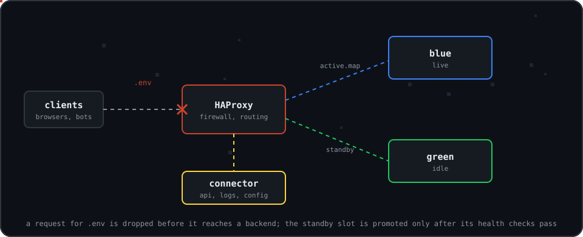
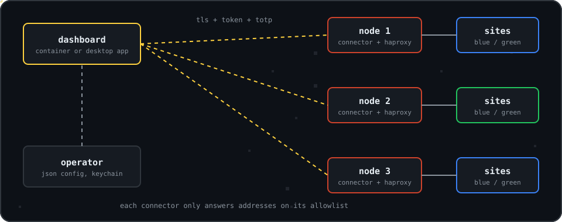

<div align="center">



**Self-hosted blue/green deploys for one site, or for a fleet of nodes behind one console.**

[](https://github.com/seggys116/cite/actions/workflows/ci.yml)
[](./LICENSE)
[](https://docs.docker.com/engine/)


[Modes](#two-modes) · [How it works](#how-it-works) · [Single site](#quickstart-single-site) · [Node](#quickstart-node) · [Dashboard](#dashboard-and-desktop-app) · [Security](#security) · [CI](#ci-and-releases) · [Docs](#docs)


</div>

<br>

> Cite builds a site from a GitHub branch into an idle slot, checks that it is healthy, and only then points traffic at it.
> A bad build never receives a request. In node mode the same idea runs behind HAProxy, with a firewall, maintenance pages
> and traffic analytics managed from one console.

<table>
<tr>
<td width="25%" valign="top"><b>Blue/green switch</b><br><sub>The new release is built and health-checked in the idle slot. Traffic moves by changing one entry in a map, with no proxy reload.</sub></td>
<td width="25%" valign="top"><b>Edge firewall</b><br><sub>Path, method, user agent, address and host rules that deny, silently drop or tarpit. Four presets cover common probes.</sub></td>
<td width="25%" valign="top"><b>Analytics</b><br><sub>Requests, status classes, latency percentiles, top paths and header-first bot scoring from HAProxy's own logs, kept in an embedded SQLite database with set retention and CSV export.</sub></td>
<td width="25%" valign="top"><b>Many nodes, one console</b><br><sub>A connector on each node exposes an authenticated API. The dashboard talks to all of them and can replicate a site to every node.</sub></td>
</tr>
</table>

## Two modes

| | Single-site mode | Node mode |
|---|---|---|
| Compose file | `docker-compose.yml` | `docker-compose.node.yml`, optionally with `docker-compose.orchestrator.yml` |
| Sites | One, from one GitHub repo | Many, routed by host name and optional path regex |
| Components | `manager` and `executor` sharing a volume | HAProxy and the connector, plus a manager and executor per site when orchestration is on |
| Control | `docker compose exec manager cite status` | Connector API on port 7443, driven by the dashboard or the desktop app |
| Docker socket | Never mounted | Only with the orchestrator overlay, through a filtering proxy |

Single-site mode is two containers, no dashboard, no database and no Docker socket. Node mode adds those pieces and the trade-offs that come with them. [Security model](docs/security-model.md) lists what changes.

<p align="center"></p>

## How it works

In single-site mode the manager polls a GitHub branch, downloads the tarball and builds it as an unprivileged user. It writes the result into the idle slot, and the executor switches to it atomically once it is healthy.

In node mode HAProxy sits in front. The connector renders `haproxy.cfg` from a JSON model, writes two map files, and receives HAProxy's logs on a unix datagram socket. A request is checked against the firewall, then against the maintenance map, then routed to the backend named in `active.map`.

<p align="center"></p>

Deploying to a site stages the new targets in the idle slot, which is a config change and reloads HAProxy once. Switching traffic afterwards, and toggling maintenance mode, are runtime map updates that need no reload. [Firewall and maintenance](docs/firewall.md) explains the mechanism.

<p align="center"></p>

## Topology

<p align="center"></p>

Each node is independent. A node keeps serving if the dashboard is offline, because HAProxy reads its config and maps from disk.

<p align="center"></p>

## Quickstart: single site

```bash
git clone https://github.com/seggys116/cite.git
cd cite
cp .env.example .env
# edit .env: set CITE_REPO=owner/name and CITE_GITHUB_TOKEN=<PAT with contents:read>
docker compose up -d
# site listens on http://127.0.0.1:8080 (override with CITE_PORT / CITE_BIND)
docker compose exec manager cite status
```

Requirements: Docker Engine 26+ and Compose v2.26+. See [docs/install.md](docs/install.md).

Images are published to `ghcr.io/seggys116` (used by `docker-compose.yml`) and mirrored to Docker Hub as `docker.io/seggy116`. Rust sites use a separate image pair, `cite-manager-rust` and `cite-executor-rust`; see [docs/sites.md](docs/sites.md#rust).

| Piece | Role |
|---|---|
| `manager` | Poll GitHub, fetch tarball, build as uid 10002, promote into `blue`/`green` |
| `executor` | Shell-less HTTP server and SSR supervisor; atomic slot switch |
| Shared volume | At most two built releases and tiny JSON control, status and state files |

<p align="center"></p>

## Quickstart: node

### With the installer

`scripts/setup.sh` writes the compose files and a mode 600 `.env` into an install directory (`~/cite`, or `/opt/cite` as root), pulls the images, runs `init` and starts the stack. It prompts for anything you leave out, so the first command below is enough:

```bash
curl -fsSL https://raw.githubusercontent.com/seggys116/cite/main/scripts/setup.sh | sh
```

The same install without prompts:

```bash
curl -fsSL https://raw.githubusercontent.com/seggys116/cite/main/scripts/setup.sh | sh -s -- \
  --mode node --allow 203.0.113.10 --bind 203.0.113.20 --yes
```

The credentials from `init` are printed once. The installer also copies the node's CA certificate to `cite-ca.pem` in the install directory.

| Option | Meaning |
|---|---|
| `--mode node\|dashboard\|both` | What to install. |
| `--dir PATH` | Install directory. |
| `--allow LIST` | IPs or CIDRs allowed to connect, comma separated. `allow-all` opens it to everyone after a confirmation. |
| `--bind IP`, `--port PORT` | Address and port of the connector API (default port 7443). |
| `--http-port PORT`, `--https-port PORT` | Public ports of HAProxy (80 and 443). |
| `--dashboard-bind IP`, `--dashboard-port PORT` | Address and port of the dashboard (127.0.0.1 and 8088). |
| `--orchestrator` | Add the orchestrator overlay and set `DOCKER_GID` in `.env`. |
| `--version X.Y.Z` | Image version. |
| `--ref GIT_REF` | Git ref to download the compose files from. The default is `v<version>` when that tag exists, otherwise `main`. |
| `--verify` | Print the SHA-256 of each downloaded compose file. |
| `--yes` | Never prompt. |
| `--no-start` | Write the files and stop before pulling and starting. |
| `--purge` | With `uninstall`, also remove volumes and installed files. |

The installer keeps a copy of itself as `cite-setup.sh` in the install directory. It takes four more commands:

```bash
~/cite/cite-setup.sh status
~/cite/cite-setup.sh update      # pulls new images and recreates containers; volumes and credentials are kept
~/cite/cite-setup.sh logs node   # or: logs dashboard
~/cite/cite-setup.sh uninstall   # add --purge to delete volumes
```

### By hand

Two values in `.env` are required, and compose refuses to start without them:

| Variable | Meaning |
|---|---|
| `CITE_CONNECTOR_ALLOW` | Addresses or CIDRs allowed to reach the connector API, comma or space separated. `0.0.0.0/0` is refused unless the list also contains `allow-all`. |
| `CITE_CONNECTOR_BIND` | Host IP the connector port is published on. |

```bash
git clone https://github.com/seggys116/cite.git
cd cite
cat >> .env <<'EOF'
CITE_CONNECTOR_ALLOW=203.0.113.10
CITE_CONNECTOR_BIND=203.0.113.20
EOF
docker compose -f docker-compose.node.yml run --rm --no-deps init
docker compose -f docker-compose.node.yml run --rm --no-deps connector init
docker compose -f docker-compose.node.yml up -d
```

The first command prepares the volumes (the compose `init` service). The second is the connector's `init` subcommand, which creates the login and the node's TLS certificate authority. It prints the username (default `admin`), a 24-character password and a TOTP key with a QR code, then the CA certificate path and its SHA-256 fingerprint. They are shown once. The connector refuses to start its API until `init` has run.

HAProxy publishes ports 80 and 443 (`CITE_HTTP_PORT`, `CITE_HTTPS_PORT`, `CITE_PUBLIC_BIND`). The connector API listens on 7443 (`CITE_CONNECTOR_PORT`). `docker compose -f docker-compose.node.yml ps` shows the connector as healthy once it is up.

To let the connector build and run sites from GitHub itself, set `DOCKER_GID` in `.env` to the group id that owns `/var/run/docker.sock` (`stat -c %g /var/run/docker.sock`) and add the orchestrator overlay:

```bash
docker compose -f docker-compose.node.yml -f docker-compose.orchestrator.yml up -d
```

Without it, a site routes to upstream addresses you run yourself. [Running a node](docs/node.md) covers every setting, and [Orchestrator](docs/orchestrator.md) covers what the overlay changes.

<p align="center"></p>

## Dashboard and desktop app

The dashboard is a browser console with seven views: Overview, Nodes, Sites, Traffic, Firewall, Maintenance and Settings. A node switcher scopes every view to one node or to all of them. Signing in takes a username, a password and a six-digit authenticator code. A node is added with a name, its connector URL and a connector API token, plus the node's CA certificate when it uses the one from `init`.

```bash
docker compose -f docker-compose.dashboard.yml up -d
docker compose -f docker-compose.dashboard.yml logs dashboard
```

Open `http://127.0.0.1:8088` and enter the one-time setup token from the log to create the first account. `scripts/setup.sh --mode dashboard` (or `both`) does the same through the installer.

The console source is in `crates/cite-dashboard/web`. [Dashboard](docs/dashboard.md) describes each view and the API the console uses.

The desktop app in `apps/desktop` is a native client for the same connector API, with the same views. It talks to the connectors directly, so it needs no dashboard container, and it keeps each node's API token in the operating system keychain. Builds for macOS, Linux and Windows are unsigned. See [Desktop app](docs/desktop.md).

## Adding a site

Open Sites, then Create site. The form asks for:

| Field | Notes |
|---|---|
| Hosts | One to 64 host names, exact or `*.example.com`. Requests with a matching `Host` header go to this site. |
| Path regex | Optional. When set, the site only receives paths that match, so an API can share a host with a front end. |
| Blue and green targets | `host:port` upstreams per slot. At least one blue target is needed. |
| Health check path | Must start with `/`. Defaults are every 2000 ms, healthy after 2 passes and down after 3 failures. |
| Nodes | Selected nodes, or Replicate to all nodes. |

Targets that point back at the node are refused: loopback, link-local, unspecified and multicast addresses, `localhost`, and the names of Cite's own services. The form creates a site that routes to upstreams you run. A site that the connector builds from GitHub is created through the API with a `source` and a `github_token`; see [Orchestrator](docs/orchestrator.md).

A later deploy writes new targets into the idle slot, waits up to 60 seconds for every target to pass its health check, then flips the active slot. If a check fails the active slot is untouched and the attempt is recorded as `failed`. Roll back from the site page, which returns traffic to the previous slot.

<p align="center"></p>

## Firewall and maintenance

Rules run in list order before routing. Each has an action: `deny` answers 403, `drop` closes the connection without a reply, and `tarpit` holds the request for 5 seconds before failing it. Matchers cover path regex, path prefix, method, user agent regex, client CIDR and host, and a rule can be limited to one site.

Four presets add ready-made rules: `sensitive-files`, `cms-probes`, `scanners` and `odd-methods`. A per-IP limit of 600 requests per 10 seconds applies by default and answers 429.

Maintenance mode serves an HTML page with status 503 by default for one site while leaving the others alone. Custom pages can use any status from 400 to 599. See [docs/firewall.md](docs/firewall.md).

## Analytics and retention

HAProxy sends one log line per request to the connector. The connector writes every request to an embedded SQLite database under `/conf/analytics/`, with header-first bot scoring, and nothing is discarded before its retention age. Data can be exported as CSV or NDJSON.

Retention is the `retention` object in the node's settings. The dashboard edits it under Settings, and the API under `GET` and `PUT /api/v1/settings`.

| Field | Default | Meaning |
|---|---|---|
| `hour_buckets_days` | 90 | How many days of requests are kept before age-based removal (1 to 3650 days). |
| `audit_days` | 365 | How long audit log entries are kept (1 to 3650 days). |
| `store_user_agents` | `true` | Record user agents. |
| `store_client_ips` | `true` | Record client addresses. |

Turning off client IPs or user agents also erases what was already stored. Query strings are never stored, only their length. There is no size cap unless you set `CITE_ANALYTICS_MAX_BYTES` (8 MiB to 1 TiB), in which case the oldest rows go first. Queries take a time window of 15 minutes to 30 days and can be limited to one site. See [docs/analytics.md](docs/analytics.md).

<p align="center"></p>

## Security

Single-site mode keeps its original posture: no Docker socket, a shell-less executor, builds as an unprivileged user and a read-only root filesystem. See [hardening](docs/hardening.md) and the [threat model](docs/threat-model.md).

In node mode, the connector API is reached in this order: source address allowlist, TLS, then a bearer token. Logging in needs a password and a TOTP code. Five failures lock a client for 30 seconds, doubling up to 15 minutes, and a reset of credentials signs out every session without a restart. API tokens cannot create or revoke tokens. Tokens and sessions are stored as SHA-256 hashes. Every configuration change is validated before it is rendered, and the rendered file is checked with `haproxy -c` before HAProxy loads it (unless `CITE_HAPROXY_VALIDATE` is set to false). HAProxy's admin and master sockets are unix sockets on a volume shared by HAProxy and the connector, not network listeners.

The orchestrator overlay gives the connector access to the Docker API through `cite-dockerproxy`, a filter that forwards only the calls the orchestrator makes and only when the request body matches the container, volume or network specification it would send. A compromised connector can then manage Cite's own site stacks but cannot ask Docker for a privileged container or a host mount. The proxy itself holds the Docker socket, so its compromise is host root. The [security model](docs/security-model.md) lists this and the other limits.

## CI and releases

| Workflow | Runs on | What it does |
|---|---|---|
| `ci.yml` | Push to `main`, pull request | `cargo fmt`, clippy with warnings denied, the workspace tests, an MSRV check on Rust 1.88, `cargo deny`, and hadolint plus image builds for the single-site images. |
| `node.yml` | Push to `main`, pull request | Syntax and static-safety checks on the dashboard scripts, compose file validation (including a check that only `dockerproxy` mounts the Docker socket), shellcheck and dry runs of `scripts/setup.sh`, builds of the connector, dashboard and dockerproxy images, and `haproxy -c` on a rendered sample config. |
| `apps.yml` | Push to `main`, pull request | Builds the desktop app for macOS arm64, macOS x64, Linux x64 and Windows x64, and the connector and dashboard binaries for Linux x64 and macOS arm64. Everything is uploaded as workflow artifacts. The Windows build is marked experimental and does not fail the workflow. |
| `e2e.yml` | Push to `main`, manual | First-deploy, fault and per-runtime end-to-end scripts for single-site mode. |
| `release.yml` | Tag `v*` | Multi-arch single-site images, and `cite-manager` and `cite-executor` musl binaries for Linux x64 and arm64 attached to the GitHub release. |
| `release-node.yml` | Tag `v*` | Multi-arch (amd64, arm64) `cite-connector`, `cite-dashboard` and `cite-dockerproxy` images to `ghcr.io/seggys116` and Docker Hub. The tag must match the version in `Cargo.toml`. |
| `release-apps.yml` | Tag `v*`, manual with a tag | Builds the same desktop and server artifacts as `apps.yml` and attaches them, with SHA-256 files, to the GitHub release. |

Desktop builds are not signed or notarised. On macOS, open the app with right-click, then Open, the first time. Windows shows SmartScreen, and you can choose More info, then Run anyway.

`scripts/e2e-node.sh` runs the node stack end to end against a throwaway compose project (`cite-e2e`, ports 18080 and 17443). It needs a connector image tagged `ghcr.io/seggys116/cite-connector:e2e`, which you can build with `docker build -f images/connector/Dockerfile --build-arg VERSION=0.2.0 -t ghcr.io/seggys116/cite-connector:e2e .`. No workflow runs it. `E2E_KEEP=1` skips the teardown.

## Requirements

| Component | Minimum |
|---|---|
| Docker Engine | 26.0 (named volume subpath mounts, Engine API 1.45) |
| Docker Compose | v2.26 |
| Host | Linux for the server side. HAProxy, the connector and the dashboard run in containers. |
| Desktop app | macOS 13 or newer, Linux, or Windows. Building from source needs Rust 1.88. |
| GitHub token | `contents:read` on each repo built (single-site mode, and orchestrated sites) |

## Local development

```bash
cp .env.example .env    # set CITE_REPO and CITE_GITHUB_TOKEN
docker compose -f docker-compose.dev.yml up --build
# optional mock GitHub profile (see docs/troubleshooting.md):
docker compose -f docker-compose.dev.yml --profile mock up --build
./scripts/smoke.sh                 # cargo build manager + executor (debug)
./scripts/assert-compose.sh
```

The desktop app is a separate Cargo workspace: `cd apps/desktop && cargo run --release -- --demo`.

Timing benchmarks are `#[ignore]` tests, so a normal `cargo test` skips them. They print their own measurements, so the numbers depend on your machine. Run them in release mode on a quiet one:

```bash
cargo test -p cite-edge --release --test perf -- --ignored --nocapture
cargo test -p cite-connector --release perf_api -- --ignored --nocapture
cargo test -p cite-dashboard --release --test perf -- --ignored --nocapture
cargo test -p cite-dockerproxy --release --test perf -- --ignored --nocapture
```

The `cite-edge` run covers log ingest rate, dashboard query latency over 90 days of events, and config render and validation time at 1, 100 and 1000 sites. The connector run covers the API with 500 sites; `perf_apply_500_sites` and `perf_unix_receive` in the connector's `haproxy` and `logsink` modules are the other two. `CITE_PERF_N` sets the event count for the ingest test.

<p align="center"></p>

## Docs

| Single-site mode | Node mode |
|---|---|
| [Install and disk sizing](docs/install.md) | [Running a node](docs/node.md) |
| [Configuration reference](docs/config.md) | [Dashboard](docs/dashboard.md) |
| [How blue-green works](docs/how-it-works.md) | [Desktop app](docs/desktop.md) |
| [Hardening](docs/hardening.md) | [Firewall and maintenance](docs/firewall.md) |
| [Threat model](docs/threat-model.md) | [Analytics and retention](docs/analytics.md) |
| [Troubleshooting](docs/troubleshooting.md) | [Orchestrator](docs/orchestrator.md) |
| [Multiple sites](docs/multi-site.md) | [Connector API](docs/node-api.md) |
| [Running real sites](docs/sites.md) | [Security model](docs/security-model.md) |
| [HTTPS in front](docs/https.md) | [Site status, logs and build settings](docs/site-status.md) |

[SECURITY](SECURITY.md) describes how to report a vulnerability.

<br>

<p align="center"><sub>MIT licensed &middot; &copy; 2026 Zak Noble-Clarke</sub></p>
